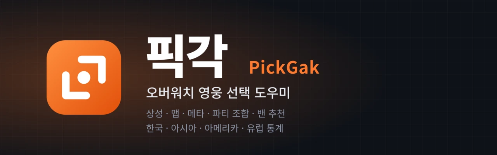
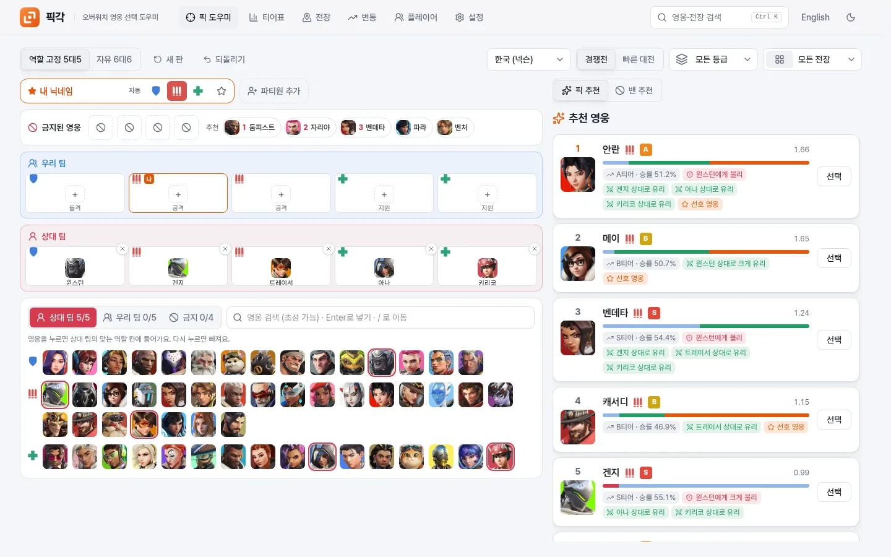
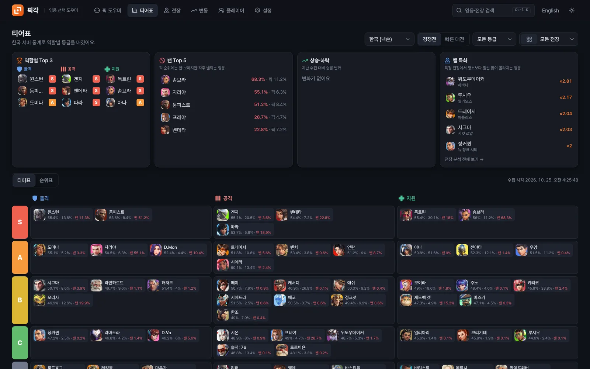
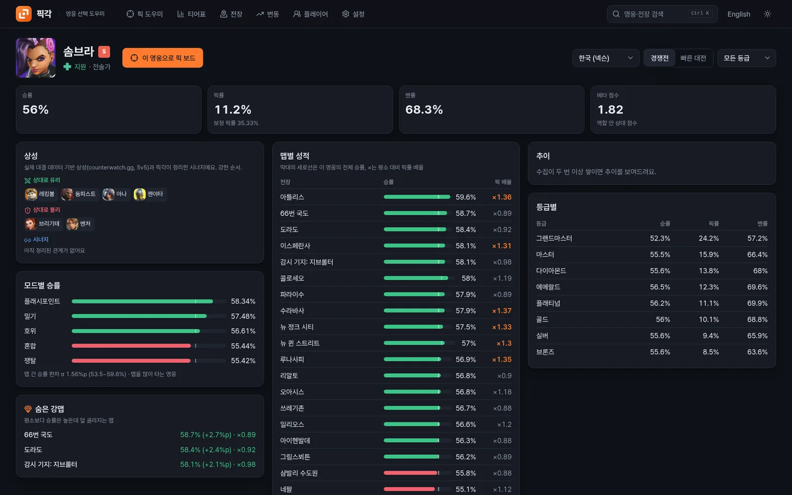
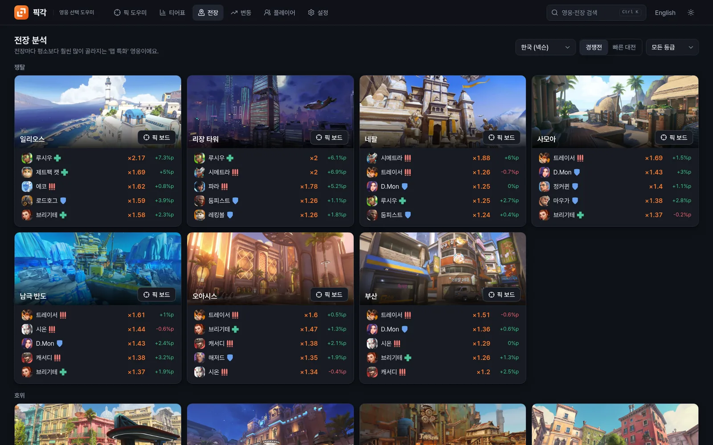

<p align="center">
  
</p>

<p align="center">
  <a href="https://github.com/seolcu/pickgak/actions/workflows/ci.yml"></a>
  
  
  
</p>

<p align="center"><a href="README.md">English</a> · <b>한국어</b> · <a href="https://pickgak.seolcu.com">pickgak.seolcu.com</a></p>

<p align="center">
  픽각은 전장, 상대 조합, 우리 팀, 파티원, 선호 영웅을 보고 이번 판에 고를 영웅을 추천합니다.<br>
  한국·아시아·아메리카·유럽 공식 통계를 매일 자동으로 모으고 실제 대결 데이터로 만든 상성으로 추천 이유를 함께 보여 줍니다.
</p>

---

## 한눈에 보기

| 픽 도우미 | 티어표 · 대시보드 |
| :---: | :---: |
|  |  |
| **영웅 상세** | **전장 분석** |
|  |  |

## 왜 픽각인가

owtics.gg, ow-athena.com 같은 통계 사이트에서도 티어와 승률을 볼 수 있습니다. 픽각은 그 통계에 이번 판의 상대 조합, 파티, 선호 영웅을 더해 고를 영웅을 정합니다.

| | 통계 사이트 | 픽각 |
| --- | :---: | :---: |
| 티어, 승률·픽률·밴률, 맵별·등급별 통계 | 있음 | 있음 |
| 상대 조합에 맞춘 카운터 픽 추천 | – | 있음 |
| 파티(듀오·트리오) 조합 추천 | – | 있음 |
| 밴 투표 추천 (우리 영웅을 지키는 밴) | – | 있음 |
| 영웅별 상성·시너지 | – | 있음 |
| 내 선호 영웅 반영 | – | 있음 |

## 기능

- **픽 보드**: 늘 보이는 영웅 입력판에서 영웅을 한 번 누르면 맞는 역할 칸에 들어갑니다. 다시 누르면 빠지고 이름을 쓰고 Enter를 눌러도 됩니다.
  - 역할 고정 5대5(돌격 1·공격 2·지원 2, 기본)와 자유 6대6을 지원합니다.
  - 영웅은 한글 초성(`ㄹㅇ` → 라인하르트)으로도 찾을 수 있고 전장은 이미지로 고릅니다.
  - '새 판'은 영웅, 금지, 전장을 비우고 파티와 역할은 그대로 둡니다. <kbd>Ctrl</kbd>+<kbd>Z</kbd>로 되돌릴 수 있습니다.
  - 1440×900 화면 하나에 입력판과 추천이 함께 들어갑니다([UX 측정, 영어](docs/ux-metrics.md)).
- **파티**: 파티원마다 [자동·돌격·공격·지원] 버튼으로 이번 판 역할을 정하면 시너지까지 따져 파티 전체에 가장 좋은 조합을 찾습니다.
  - 등록하지 않은 친구도 이름만 쓰면 바로 넣을 수 있습니다.
  - ★ 버튼으로 사람마다 '선호 영웅만'을 켜고 끕니다.
- **추천 이유**: 전장 승률, 메타 티어, 상성(크게 유리·불리), 시너지, 선호 영웅을 칩으로 보여 줍니다.
- **팀 구성**: 조합 유형(다이브·포킹·러쉬·앵커)과 유형 간 상성, 딜러·힐러의 메인·서브 짝, 고HPS 힐러 한 명 이상, 위험 플레이어(유난히 잘하는 상대를 표시하면 더 강하게 카운터)를 함께 봅니다. 원칙과 출처는 [docs/team-building.md](docs/team-building.md)(영어)에 있습니다.
- **로비 밴과 칸 바꾸기**: 같은 역할 한도를 넘을 수 있는 5번째 금지를 켤 수 있고 같은 역할 칸끼리 바꿔 게임 화면 순서에 맞출 수 있습니다.
- **밴**: 금지 줄의 밴 추천 칩을 누르면 바로 금지됩니다. 밴 단계에는 밴 투표 1~3순위 추천이 자동으로 열립니다.
- **티어표와 순위표**: 역할별 S~D 티어, 정렬할 수 있는 순위표, 대시보드(역할별 상위, 밴 상위, 상승·하락, 맵 특화)를 제공합니다.
- **영웅 상세**: 맵별·모드별 승률, 숨은 강맵, 맵 의존도, 등급별 표, 추이, 상성과 시너지를 보여 줍니다.
- **전장 분석**: 맵마다 평소보다 훨씬 많이 골라지는 영웅을 찾습니다.
- **변동**: 지난 수집, 7일 전, 30일 전과 비교해 많이 오르고 내린 영웅을 보여 줍니다.
- **빠른 검색**: <kbd>Ctrl</kbd>/<kbd>⌘</kbd>+<kbd>K</kbd>로 영웅, 전장, 화면을 찾아갑니다.
- **계정(선택)**: 로그인하지 않아도 모든 기능을 쓸 수 있습니다. 이때 프로필은 브라우저에 저장됩니다. 회원은 아이디와 비밀번호만으로 가입하고 어느 기기에서나 같은 프로필을 씁니다. 비밀번호를 잊으면 가입할 때 한 번 받은 복구 코드로 되찾습니다.
- **언어와 테마**: 한국어와 영어(브라우저 언어를 따름), 시스템·라이트·다크 테마를 지원합니다. 모바일 화면과 홈 화면 설치(PWA 아이콘)도 됩니다.

## 데스크톱 앱 (v2, 알파)

게임 중에 TAB을 누르고 있으면 픽각이 게임 창을 한 장 찍어 점수판을 읽고 판을 채운 뒤 작은 오버레이 창에 추천을 보여 줍니다. 게임 프로세스에는 손대지 않고(주입·메모리·패킷·게임 파일 없음) TAB을 누르지 않는 동안에는 아무 일도 하지 않습니다. 리눅스(X11/XWayland)와 Windows 10 1903 이상에서 동작합니다. 동작 방식, 안전, 개인정보, 측정값은 [docs/v2.md](docs/v2.md)(영어)에 정리돼 있습니다.

## 안전 원칙

> 픽각은 게임 클라이언트, 메모리, 네트워크 패킷, 게임 폴더에 접근하지 않습니다.

공개된 웹 통계와 사용자가 직접 입력한 정보만 씁니다.

| 데이터 | 출처 | 갱신 |
| --- | --- | --- |
| 영웅 승률·픽률·밴률 (PC; 한국·아시아·아메리카·유럽; 경쟁전 등급별과 빠른 대전; 맵별) | [넥슨 공식 영웅 통계](https://overwatch.nexon.com/hero/rate) | 지역마다 하루 한 번쯤 자동 (요청 사이 1초) |
| 영어 영웅·전장 이름 | [Blizzard 공식 통계](https://overwatch.blizzard.com/en-us/rates/) | 자동 수집 때 함께 |
| 영웅 초상화 | 넥슨 CDN (공식 통계 페이지가 가리키는 주소) | 브라우저가 바로 불러옴 |
| 데스크톱 앱: TAB 초상화 인식 (영웅별 2D 초상화를 32x32로 줄인 것) | [나무위키](https://namu.wiki/) 영웅 문서 | 영웅이 추가될 때 앱에 넣음 (`app/scripts/make-seeds.py`) |
| 상성 평점 (실제 대결·교전, 5v5) | [counterwatch.gg](https://www.counterwatch.gg/stats/overwatch/counters) | 가끔 직접 (`python -m app.collector.counterwatch`) |
| 전장 이미지 | [OverFast API](https://overfast-api.tekrop.fr/maps), 없으면 counterwatch.gg | 처음 한 번 받아 서버에 저장 |
| 등급 엠블럼 | owtics.gg 에셋 | 처음 한 번 받아 서버에 저장 |

## 실행

```bash
# 백엔드: 켜 두면 통계를 알아서 모으고 갱신합니다
cd backend
uv sync
uv run uvicorn app.main:app --port 8000

# 프론트엔드
cd frontend
npm install
npm run dev    # http://localhost:5173  (같은 와이파이의 폰: http://<PC IP>:5173)
```

**배포(단일 컨테이너)**: 루트의 `Dockerfile`이 프론트엔드를 빌드하고 백엔드가 화면까지 함께 내보냅니다.

```bash
docker build -t pickgak .
docker run -d -p 8000:8000 -v ./data:/data -e PICKGAK_SECURE_COOKIE=1 -e PICKGAK_TRUST_PROXY=1 pickgak
```

- DB와 받은 이미지는 `/data`에 둡니다.
- HTTPS 프록시 뒤라면 `PICKGAK_SECURE_COOKIE=1`로 로그인 쿠키를 HTTPS 전용으로 만듭니다.
- 컨테이너에 그 프록시를 거쳐서만 들어올 수 있다면 `PICKGAK_TRUST_PROXY=1`도 켭니다. 시도 제한이 실제 접속 IP로 동작합니다.
- `PICKGAK_SIGNUP_DAILY_CAP`으로 하루 가입 수 상한을 정합니다(기본 200).
- 배포 모드에서는 보안 헤더와 엄격한 CSP를 보내고 다른 사이트에서 온 쓰기 요청을 거부하며 API 문서를 숨깁니다.

**자동 수집**: 서버는 한 시간마다 확인해서 통계가 20시간보다 오래된 지역(한국·아시아·아메리카·유럽)을 다시 받습니다.
- 처음 실행하면 지역마다 등급 합산 통계를 먼저 받습니다. 한국은 1~2분이면 준비되고 등급별 통계는 뒤에서 이어서 채웁니다.
- 중간에 끊기면 다음 확인 때 다시 받습니다.
- 끄려면 `PICKGAK_AUTOCOLLECT=0`을 설정합니다. 직접 돌리려면 `uv run python -m app.collect --regions all --full`을 실행합니다.

## 구조

```
backend/   FastAPI + SQLite
  app/collector/   넥슨 통계, Blizzard 이름, counterwatch 상성 수집
  app/analysis/    메타 점수와 티어, 영웅 상세, 전장 분석
  app/recommend/   engine(개인 추천, 큐 규칙) / party(파티 조합) / bans(밴 추천)
  app/api/         API 경로, 계정
  app/scheduler.py 자동 수집
  data/            queues.yaml, bans.yaml, weights.yaml, matchups.json, counters.yaml
frontend/  React + Vite + TypeScript + Tailwind v4
  src/features/    pick / meta / heroes / maps / trends / players / account / settings
  src/components/  공용 UI, 영웅·전장 선택기, 차트, 로고
  src/locales/     ko, en
  src/theme/       디자인 토큰 (docs/brand.md)
```

## 조정과 확장

| 바꾸고 싶은 것 | 고칠 곳 |
| --- | --- |
| 큐 규칙 (인원, 역할 자리) | `backend/data/queues.yaml` |
| 밴 규칙 (팀당 수, 역할 한도, 투표 가중치) | `backend/data/bans.yaml` |
| 추천 점수 가중치 | `backend/data/weights.yaml` |
| 상성 평점 | `backend/data/matchups.json` (`python -m app.collector.counterwatch`로 갱신) |
| 시너지, 평점에 더하는 보조 상성 | `backend/data/counters.yaml` |
| 언어 추가 | `frontend/src/locales/<코드>/`와 `src/i18n/index.ts`의 `LANGUAGES` |
| 테마 추가 | `frontend/src/theme/tokens.css`의 `[data-theme="이름"]`과 `ThemeProvider`의 `THEMES` |

## 개발

```bash
cd backend && uv run ruff check app tests && uv run pytest
cd frontend && npm run lint && npm test && npm run build   # lint에 번역 키 검사가 들어 있습니다
```

PR마다 GitHub Actions가 위 검사를 돌립니다. 로고와 색은 [docs/brand.md](docs/brand.md)(영어)에 정리돼 있고 문체 규칙은 [docs/writing-style.md](docs/writing-style.md)(영어)에 있습니다.

## 라이선스

픽각의 코드는 [GNU GPL v3.0 이상](LICENSE)으로 공개합니다. 자유롭게 쓰고 고치고 팔아도 되지만, 고친 버전을 배포하면 그 소스도 같은 라이선스로 공개해야 합니다.

이 라이선스에 포함되지 않는 것: 오버워치와 영웅·전장 이름, 게임 그림은 Blizzard Entertainment의 것입니다. 내장 영웅 템플릿(`app/crates/vision/src/*.bin`)은 나무위키 초상화와 넥슨 영웅 썸네일에서 만든 것이라 원저작자의 권리가 그대로 남습니다. 함께 배포하는 Tesseract OCR은 Apache-2.0입니다.

---

<sub>픽각은 Blizzard Entertainment, NEXON과 관련 없는 개인 프로젝트입니다. Overwatch는 Blizzard Entertainment의 상표입니다.</sub>
