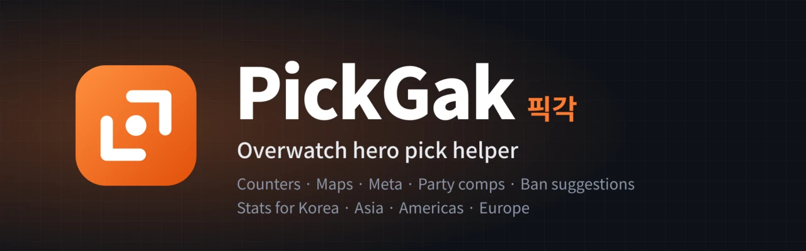
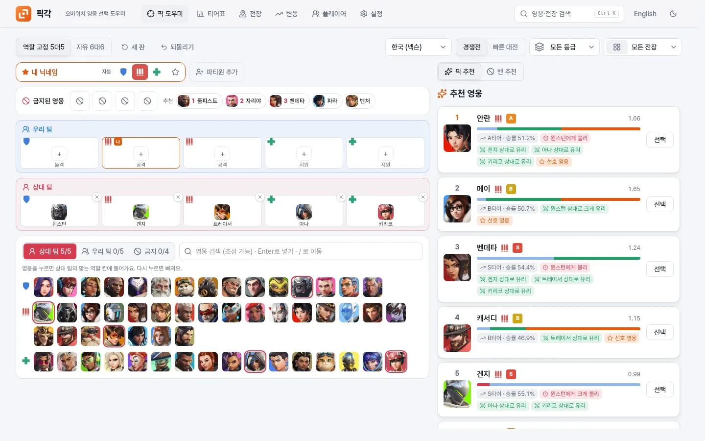
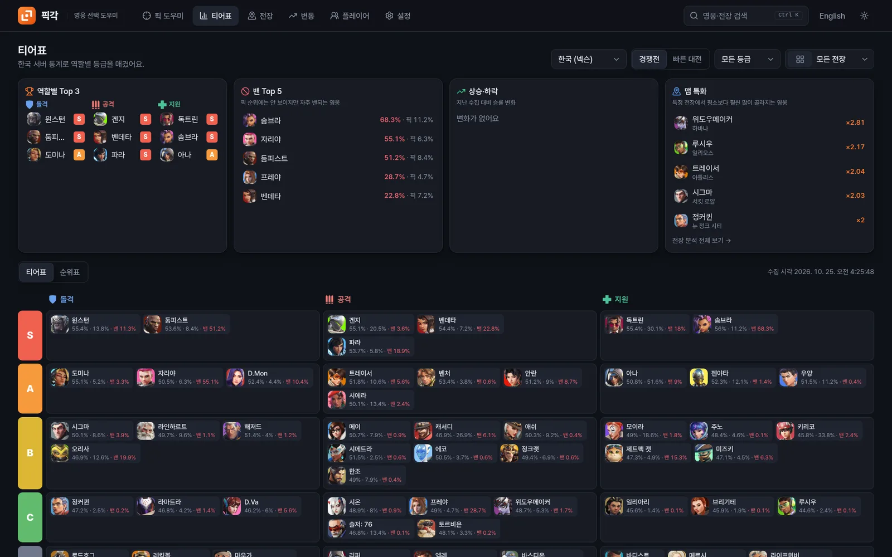
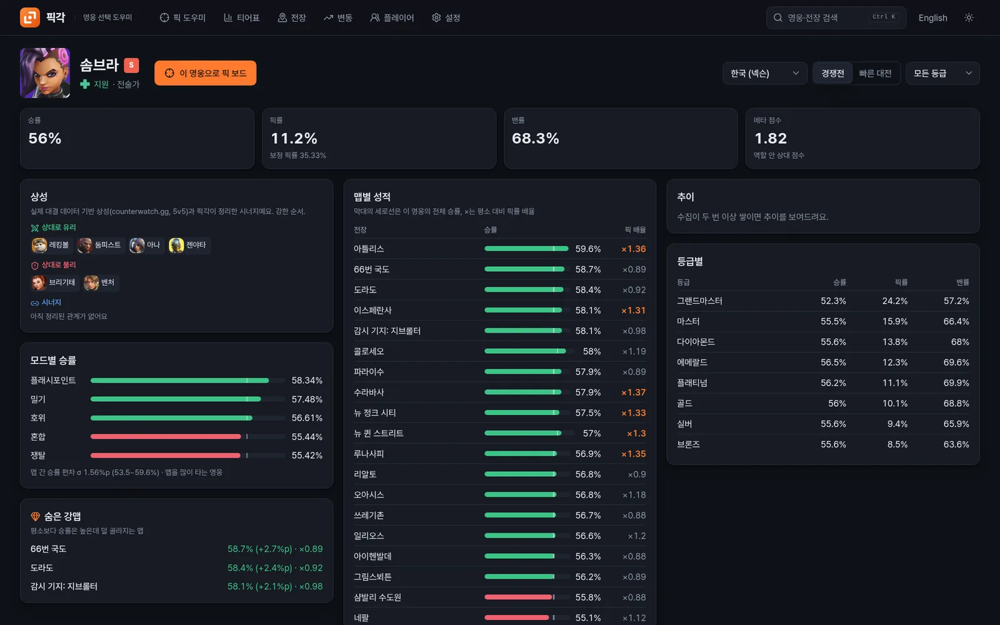
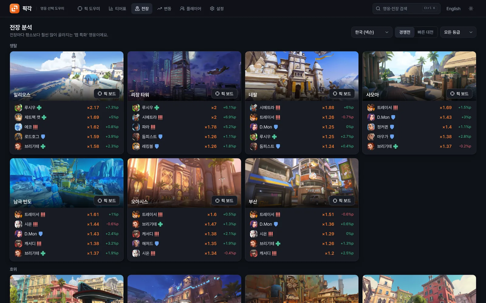

<p align="center">
  
</p>

<p align="center">
  <a href="https://github.com/seolcu/pickgak/actions/workflows/ci.yml"></a>
  
  
  
</p>

<p align="center"><b>English</b> · <a href="README.ko.md">한국어</a> · <a href="https://pickgak.seolcu.com">pickgak.seolcu.com</a></p>

<p align="center">
  PickGak looks at the map, the enemy comp, your team, your party and your preferred heroes, and recommends the hero to pick this match.<br>
  It collects official stats for Korea, Asia, the Americas and Europe every day and explains each pick with matchups from real duel data.
</p>

---

## At a glance

| Pick helper | Tier list · dashboard |
| :---: | :---: |
|  |  |
| **Hero detail** | **Map analysis** |
|  |  |

## Why PickGak

Stat sites such as owtics.gg and ow-athena.com already list tiers and win rates. PickGak adds this match's enemy comp, your party and your preferred heroes to those stats and picks a hero from them.

| | Stat sites | PickGak |
| --- | :---: | :---: |
| Tiers, win/pick/ban rates by map and rank | Yes | Yes |
| Counter-pick recommendations from the enemy comp | – | Yes |
| Party (duo/trio) composition recommendations | – | Yes |
| Ban vote suggestions (bans that protect your heroes) | – | Yes |
| Per-hero matchups and synergies | – | Yes |
| Your preferred heroes taken into account | – | Yes |

## Features

- **Pick board**: an always-visible hero grid. One click puts a hero into the matching role slot, a second click removes it, and name + Enter works too.
  - Role queue 5v5 (1 tank, 2 damage, 2 support; default) and open queue 6v6
  - Hero search understands Korean initial consonants (`ㄹㅇ` → Reinhardt); maps are picked by image
  - "New match" clears heroes, bans and the map but keeps your party and roles; <kbd>Ctrl</kbd>+<kbd>Z</kbd> undoes
  - Input and recommendations fit on one 1440×900 screen ([UX measurements](docs/ux-metrics.md))
- **Party**: set each member's role for this match with [Auto · Tank · Damage · Support]. PickGak finds the best combination for the whole party, synergy included.
  - Add an unregistered friend by just typing a name
  - ★ toggles "preferred heroes only" per person
- **Why this pick**: chips for map win rate, meta tier, matchups (strong/weak against), synergy and preferred heroes
- **Team building**: comp archetypes (dive, poke, rush, anchor) and their counters, main/sub pairing in damage and support, at least one high-output healer, and threat players (mark a smurf to counter them harder). Principles and sources: [docs/team-building.md](docs/team-building.md)
- **Lobby ban and slot swap**: an optional 5th ban that may exceed the role limit, and swapping same-role slots to match the in-game order
- **Bans**: click a suggested ban chip in the ban row; during the ban phase the ban vote suggestions (1st–3rd) open automatically
- **Tier list / ranking**: S–D per role, sortable ranking, dashboard (top per role, most banned, risers and fallers, map specialists)
- **Hero detail**: win rate per map and mode, hidden strong maps, map dependence, per-rank table, trends, matchups and synergies
- **Map analysis**: heroes picked far more than usual on each map
- **Trends**: vs. last collection / 7 days / 30 days, top risers and fallers
- **Quick search**: <kbd>Ctrl</kbd>/<kbd>⌘</kbd>+<kbd>K</kbd> for heroes, maps and pages
- **Optional account**: everything works without one, and your profiles stay in the browser. Members (username + password only) get the same profiles on every device; a one-time recovery code replaces email.
- **English / 한국어** (follows your browser locale), **system / light / dark** themes, mobile layout and home-screen install (PWA icons)

## Desktop app (v2, alpha)

Hold TAB in game and PickGak reads the scoreboard from one screenshot of the game window, fills the board and shows the top picks in a small always-on-top overlay. It never touches the game process (no injection, memory, packets or files) and does nothing between TAB presses. It runs on Linux (X11/XWayland) and Windows 10 1903 or later. Details, safety, privacy and measurements: [docs/v2.md](docs/v2.md).

## Safety

> PickGak never touches the game client, its memory, network packets or game files.

It only uses public web statistics and what you type in.

| Data | Source | Refresh |
| --- | --- | --- |
| Hero win/pick/ban rates (PC; Korea, Asia, Americas, Europe; Competitive by rank and Quick Play; per map) | [Nexon official hero stats](https://overwatch.nexon.com/hero/rate) | About once a day per region, automatically (1 s between requests) |
| English hero and map names | [Blizzard official stats](https://overwatch.blizzard.com/en-us/rates/) | With the daily collection |
| Hero portraits | Nexon CDN (linked from the official stats page) | Loaded by the browser |
| Desktop app: TAB portrait recognition (32x32 thumbnails of each hero's 2D portrait) | [Namu Wiki](https://namu.wiki/) hero pages | Built into the app when a hero is added (`app/scripts/make-seeds.py`) |
| Matchup ratings (real duels and fights, 5v5) | [counterwatch.gg](https://www.counterwatch.gg/stats/overwatch/counters) | Manually, occasionally (`python -m app.collector.counterwatch`) |
| Map images | [OverFast API](https://overfast-api.tekrop.fr/maps), counterwatch.gg as fallback | Downloaded once and cached on the server |
| Rank emblems | owtics.gg assets | Downloaded once and cached on the server |

## Running locally

```bash
# Backend: keeps collecting and refreshing stats while it runs
cd backend
uv sync
uv run uvicorn app.main:app --port 8000

# Frontend
cd frontend
npm install
npm run dev    # http://localhost:5173  (phone on the same Wi-Fi: http://<PC IP>:5173)
```

**Deploying (single container)**: the root `Dockerfile` builds the frontend and the backend serves it.

```bash
docker build -t pickgak .
docker run -d -p 8000:8000 -v ./data:/data -e PICKGAK_SECURE_COOKIE=1 -e PICKGAK_TRUST_PROXY=1 pickgak
```

- The DB and downloaded images live in `/data`.
- Behind an HTTPS proxy, set `PICKGAK_SECURE_COOKIE=1` (HTTPS-only login cookie).
- If the container is reachable only through that proxy, also set `PICKGAK_TRUST_PROXY=1` (rate limits use the real client IP).
- `PICKGAK_SIGNUP_DAILY_CAP` limits sign-ups per day (default 200).
- In production the app sends security headers and a strict CSP, rejects cross-site writes, and hides the API docs.

**Automatic collection**: while the server runs, it checks every hour and refreshes any region (Korea, Asia, Americas, Europe) whose stats are older than 20 hours.
- On first start, the all-ranks stats for each region come first (Korea is ready within 1–2 minutes); per-rank stats keep filling in the background.
- An interrupted run is retried next time.
- Disable with `PICKGAK_AUTOCOLLECT=0`; run manually with `uv run python -m app.collect --regions all --full`.

## Layout

```
backend/   FastAPI + SQLite
  app/collector/   Nexon stats, Blizzard names, counterwatch matchups
  app/analysis/    meta score and tiers, hero detail, map analysis
  app/recommend/   engine (solo picks, queue rules) / party (compositions) / bans
  app/api/         routes, accounts
  app/scheduler.py automatic collection
  data/            queues.yaml, bans.yaml, weights.yaml, matchups.json, counters.yaml
frontend/  React + Vite + TypeScript + Tailwind v4
  src/features/    pick / meta / heroes / maps / trends / players / account / settings
  src/components/  shared UI, hero and map pickers, charts, logo
  src/locales/     ko, en
  src/theme/       design tokens (docs/brand.md)
```

## Tuning and extending

| To change | Edit |
| --- | --- |
| Queue rules (team size, role slots) | `backend/data/queues.yaml` |
| Ban rules (per team, role limit, vote weights) | `backend/data/bans.yaml` |
| Recommendation weights | `backend/data/weights.yaml` |
| Matchup ratings | `backend/data/matchups.json` (refresh with `python -m app.collector.counterwatch`) |
| Synergies, hand-listed matchups added on top of the ratings | `backend/data/counters.yaml` |
| Add a language | `frontend/src/locales/<code>/` + `LANGUAGES` in `src/i18n/index.ts` |
| Add a theme | `[data-theme="name"]` in `frontend/src/theme/tokens.css` + `THEMES` in `ThemeProvider` |

## Development

```bash
cd backend && uv run ruff check app tests && uv run pytest
cd frontend && npm run lint && npm test && npm run build   # lint includes a translation-key check
```

GitHub Actions runs these checks on every PR. Brand (logo, colors): [docs/brand.md](docs/brand.md). Writing rules (language, Korean register, no emoji): [docs/writing-style.md](docs/writing-style.md).

## License

PickGak's code is licensed under the [GNU General Public License v3.0 or later](LICENSE). You may use, change and sell it; if you distribute a changed version, its source must be available under the same license.

Not covered by that license: Overwatch, its hero and map names and game art belong to Blizzard Entertainment; the built-in hero templates (`app/crates/vision/src/*.bin`) are derived from Namu Wiki portraits and NEXON's hero thumbnails and remain theirs; the bundled Tesseract OCR engine is Apache-2.0.

---

<sub>PickGak is a personal project, not affiliated with Blizzard Entertainment or NEXON. Overwatch is a trademark of Blizzard Entertainment.</sub>
