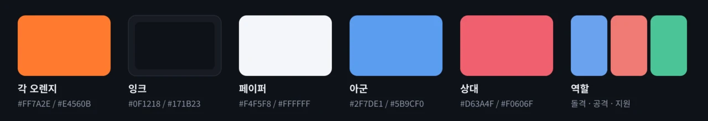

# PickGak brand

## Logo

**The final ㄱ of 픽 and the final ㄱ of 각 face each other to form an aiming frame, with a dot in the middle.**
- The top-right stroke is a plain ㄱ, and the bottom-left one is ㄱ rotated 180°.
- It reads as "aim and lock in your pick", that is "각 잡았다" (Korean slang for "nailed the angle").
- It works both as the Hangul letter ㄱ and as a crosshair.

**Files**
- Source: [`frontend/public/favicon.svg`](../frontend/public/favicon.svg)
- In-app component: `frontend/src/components/Logo.tsx`
- Home-screen icons: `apple-touch-icon.png` (180), `icon-192.png`, `icon-512.png`
- Banners: [`docs/banner.svg`](banner.svg) (English, README) and [`docs/banner.ko.svg`](banner.ko.svg) (Korean, README.ko)
  - GitHub social preview: [`docs/social-preview.svg`](social-preview.svg) (1280×640, the English banner centered)
  - Render with `magick -density 144 -background none banner.svg -resize 1280x400 banner.png`, then convert to WebP.
  - Rendering needs the Noto Sans CJK KR font.
  - Set the social preview by hand under Settings → General → Social preview. GitHub has no API for it.

**Usage rules**
- The rounded square's corner radius is 1/4 of its side.
- Stroke width is about 10% of the side, with round caps.
- The background is the Gak orange gradient (#FF8F3F → #E2500A), and the symbol is white.
- Below 16px, don't use the symbol alone; keep the background.

## Name

- Korean: **픽각**
- English: **PickGak**
- In Korean UI, prefer "픽각".

## Colors

| Name | Dark theme | Light theme | Use |
| --- | --- | --- | --- |
| Gak orange | `#FF7A2E` | `#E4560B` | Primary accent, buttons, selected state, "me" |
| Ink | `#0F1218` / `#171B23` | – | Background / cards |
| Paper | – | `#F4F5F8` / `#FFFFFF` | Background / cards |
| Ally | `#5B9CF0` | `#2F7DE1` | My team, party members |
| Enemy | `#F0606F` | `#D63A4F` | Enemy team, bans, unfavorable |
| Good | `#3CC486` | `#1F9D63` | Favorable, rising |
| Tank · Damage · Support | `#6AA1EE` · `#F07A74` · `#4CC497` | `#3F7FD8` · `#D9534F` · `#2FA37A` | Role markers (game convention) |
| Tier S–D | `#F0604F` → `#6F788B` | `#E0483B` → `#7A8396` | Tier badges |

Every color in the UI comes from the variables in [`frontend/src/theme/tokens.css`](../frontend/src/theme/tokens.css).

## Fonts

- **UI**: Pretendard Variable
- **Banner**: Noto Sans CJK KR (Black, Bold)
